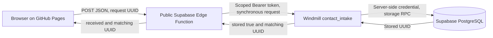

# WEB-001 architecture and rebuild map

The public site is a React/TypeScript/Vite single-page demonstration, styled with Tailwind and a shadcn/ui Button. Version B adds the Weekend Appointments callout and Request a Callback CTA. It does not book appointments or send emails.

## Components and boundaries

| Component | Implementation / responsibility |
| --- | --- |
| Browser | `src/components/contact-form.tsx`, `src/lib/contact.ts`; input validation, UUID creation, truthful success/failure, same-ID retry |
| Edge Function | `supabase/functions/contact-submit/`; independent validation, 16 KiB body limit, honeypot, exact-origin CORS, authenticated Windmill invocation |
| Windmill | One inline Bun storage step; protected resource `f/web001/supabase`; invokes `store_contact_submission` RPC |
| Database | `public.contact_submissions`, UUID primary key; duplicate insert does not overwrite; RLS and privileges deny anonymous CRUD/RPC |
| Deployment | Push to main triggers locked install, tests, typechecked Vite build, artifact upload and GitHub Pages deployment |

The Edge Function is intentionally public (`verify_jwt=false`); CORS is not authentication. Neither database credentials nor Windmill tokens belong in browser code. Windmill's credential stays in a protected resource/secret variable; its scoped invocation token stays in Edge secrets. The frontend receives only the public Edge URL.

The request is `{request_id, name, email, message, website:""}`. Explicit durable storage confirmation is required before browser success. Timeouts are 10 seconds at storage, 15 seconds at Edge and 20 seconds in the browser. A timeout does not prove the row was absent; retry preserves the original payload and UUID. Browser state is in memory, so reloading loses the retry state.

## Rebuild and transfer

Follow [BACKEND_SETUP.md](BACKEND_SETUP.md) to recreate the database, protected resource and Flow, deploy the Edge Function and set the frontend endpoint. Set Pages to GitHub Actions and configure the new Pages origin in `ALLOWED_ORIGIN`. Vite derives the repository base path in Actions. Use `npm ci`, `npm test`, and `npm run build` (or `npm.cmd` in Windows PowerShell).

The deployed Flow export is the supplied cloud snapshot. The generated Flow and standalone TypeScript include newer resource-validation diagnostics; payload validation and storage/receipt logic match the snapshot. The export does not contain secret resource values or establish account-level token scope. See [../VALIDATION.md](../VALIDATION.md).

Account invitations and operator access remain to be arranged. Credential rotation, recovery and recreation procedures are in the backend guide; a new operator's independent verification procedure is in [OPERATOR_QUICKSTART.md](OPERATOR_QUICKSTART.md).
